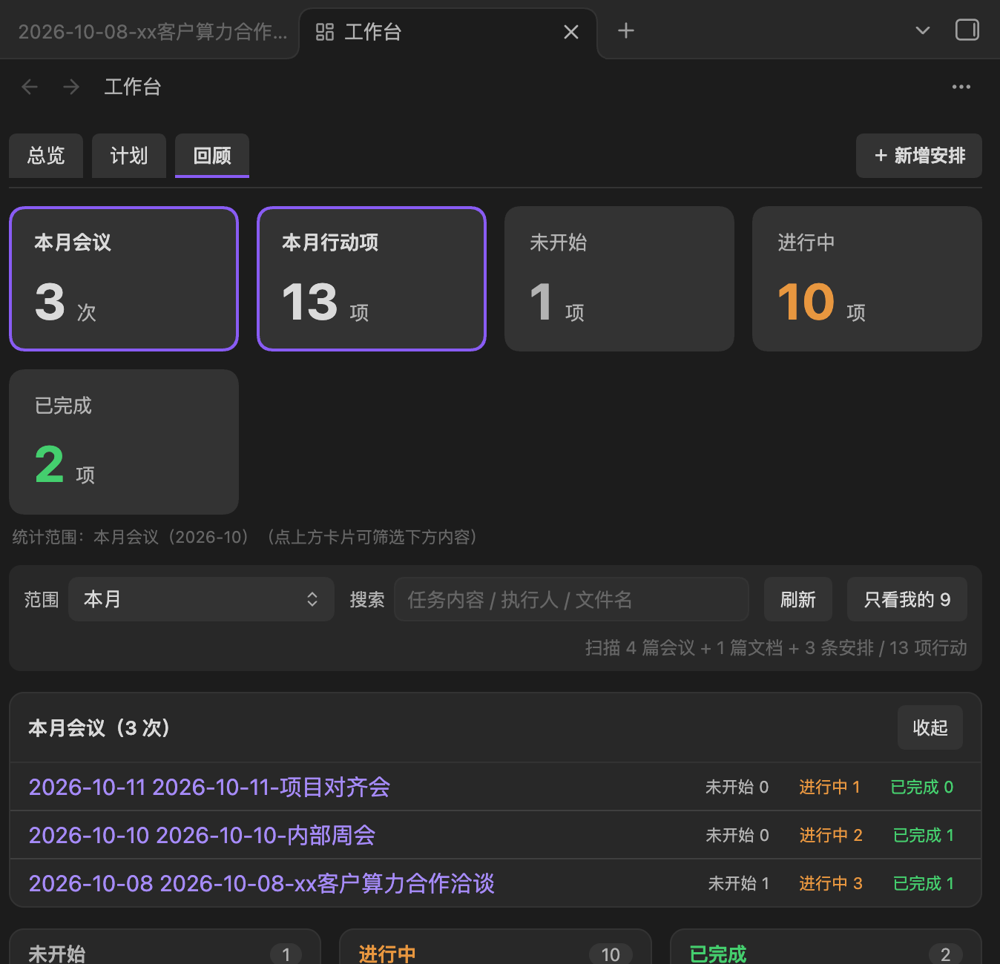
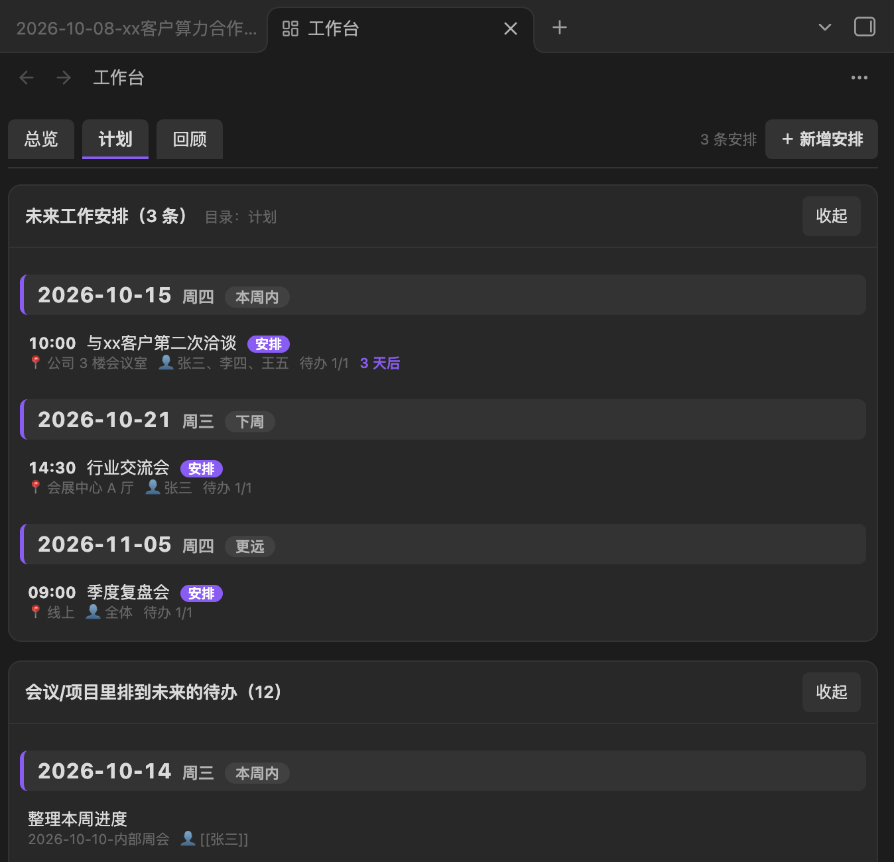
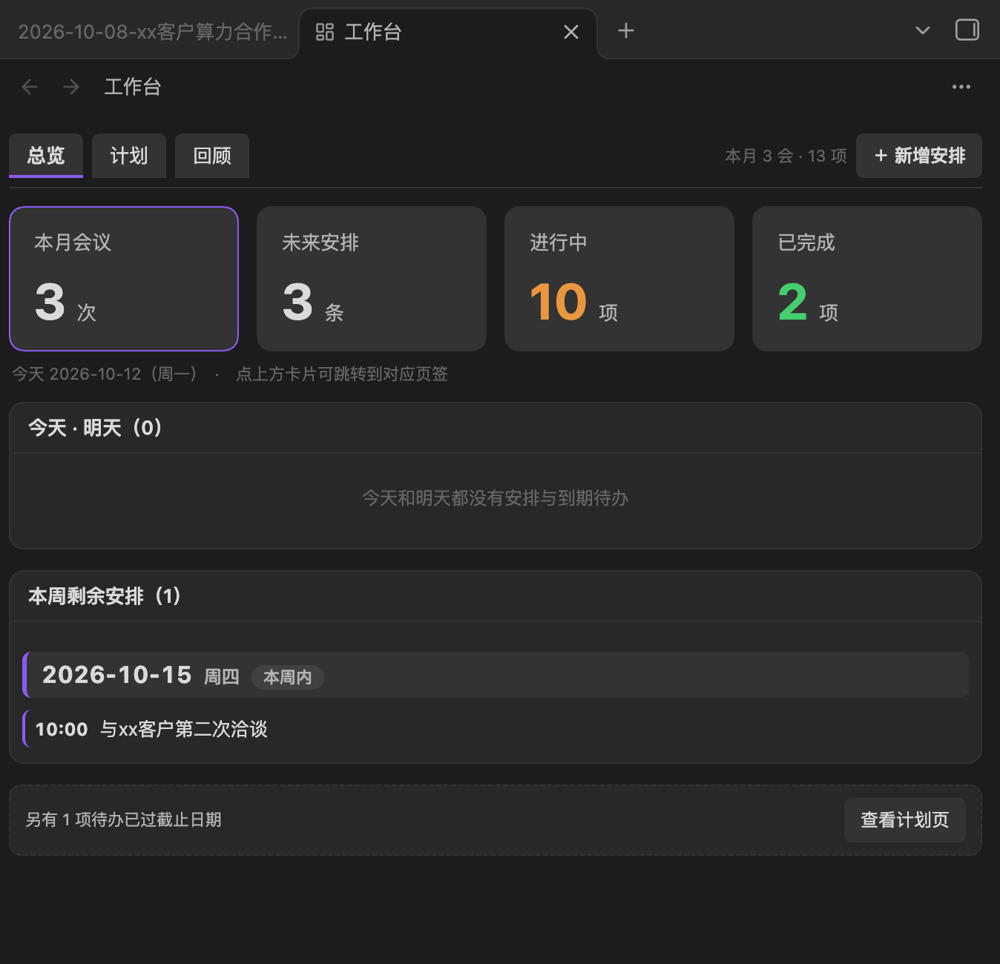
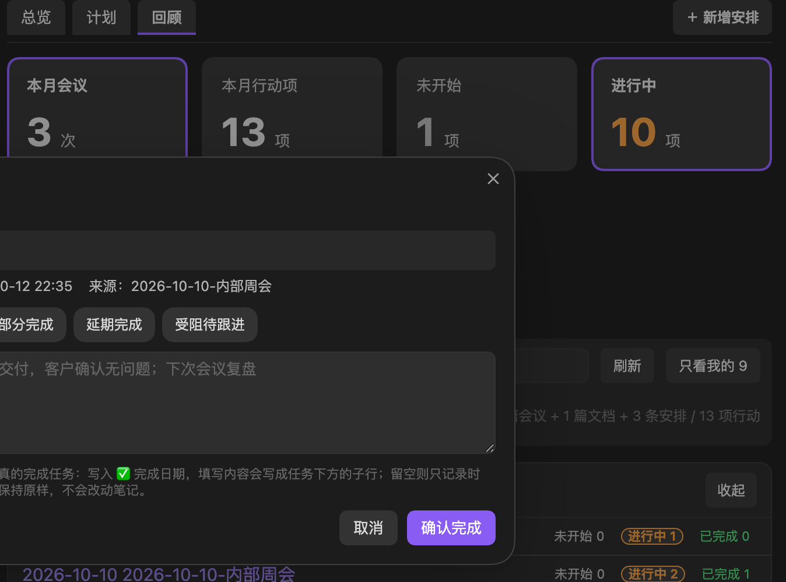
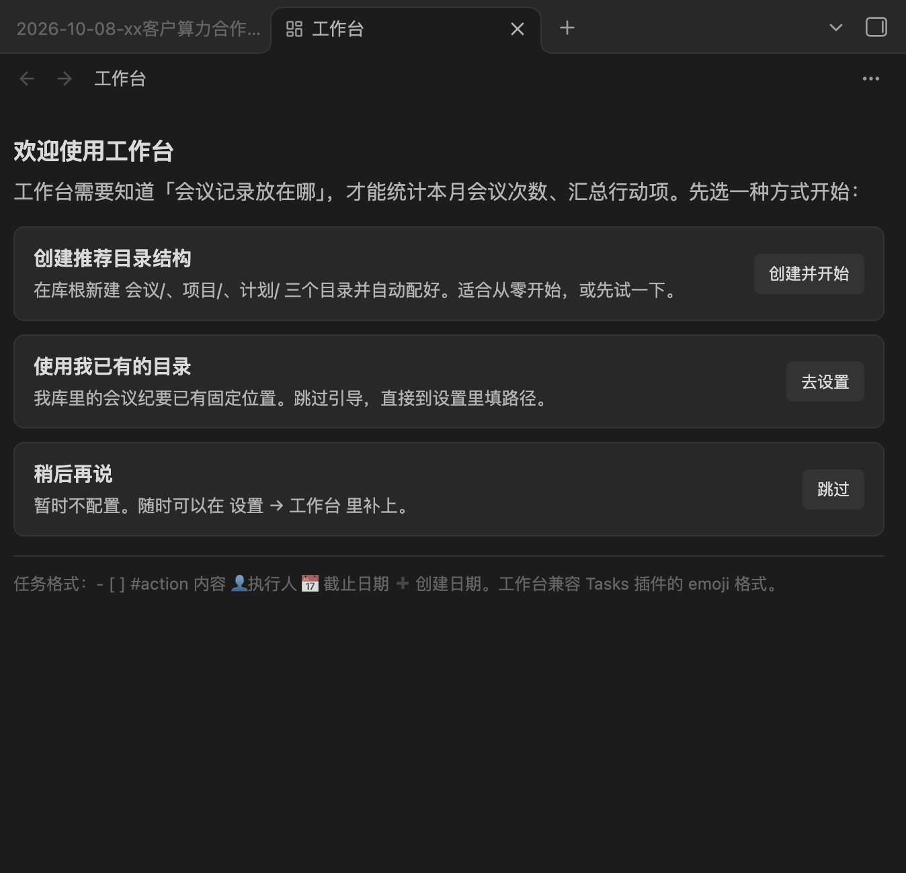

# Workbench (工作台)

[English](README.en.md) | [中文](README.md)

An Obsidian plugin that **counts your meetings, organizes action items, and manages upcoming work plans** — and makes "checking a task off" come with a completion record.

> [!note] Why this plugin exists
> Obsidian has plenty of task plugins (Tasks, Dataview, etc.), but none of them **pause to ask "how did it go?" when you check a task off**, and none of them lay meetings and their action items out on a single screen through the lens of "how many meetings did I have this month". Workbench fills exactly these two gaps: **viewing action items by meeting/project**, and **automatically recording the completion date + outcome when you check a task off**.

## Screenshots

**Review**: top stat cards (click to filter) + this month's meetings + three-column board



**Plan**: upcoming work plans grouped by date, with future-scheduled todos from meetings/projects at the bottom



**Overview**: what to do today · tomorrow



**Completion dialog**: confirm first, then record the outcome



**First-run onboarding**: tell the plugin where your folders are



## Features

Three tabs:

| Tab | What it does |
|------|--------|
| **Overview** | Today · tomorrow at a glance: merges work plans and due todos into one timeline |
| **Plan** | Upcoming work plans grouped by date; future-scheduled todos from meetings/projects at the bottom |
| **Review** | Action items from meetings and projects, on a Not started / In progress / Done three-column board |

Capabilities:

- **Monthly meeting stats** — top stat cards show this month's meeting count, action items, in-progress and done; **cards are clickable** — one click filters the board below accordingly.
- **Drill down from the meeting list** — the `In progress 2` badge on each meeting row is clickable: it shows only **that meeting's 2 tasks in that state**, not every matching task in the vault. The locked row is highlighted, a `Meeting: xxx ×` chip appears in the toolbar, and clicking any of them clears the lock.
- **Action item board** — Not started / In progress / Done three columns. Rule: a task counts as "Not started" only if `🛫 start date` is in the future; **tasks without a start date always count as "In progress"**.
- **Check to record** — after checking a task on the board, the plugin **shows a confirmation dialog first** (clicking "Cancel" leaves your note untouched byte-for-byte). On confirm it writes the standard `✅ YYYY-MM-DD` and asks for the outcome, recording your answer as a sub-line under the task.
- **Checking in the editor is captured too** — changing `- [ ]` to `- [x]` in the editor triggers the same dialog.
- **Custom time ranges** — this month / custom start-end / all meetings / whole vault, independently.
- **Only mine** — one-click filter for tasks where you are the assignee (or attendee); tell the plugin "who am I" in settings.
- **Upcoming work plans** — create entries directly in the plugin (event name / date / time / place / participants / notes), generating `YYYY-MM-DD-event.md`; supports "+1 day" postponement, editing, and collapsible panels.
- **Calendar integration** — click a date in the Calendar plugin and the daily-note file gets renamed and filled with a skeleton automatically, landing in different folders by date (see below).

## Installation

This plugin is plain JavaScript with **no build step** — `main.js` is the ready-to-load artifact.

### Manual installation

1. Download this repo, or `git clone`.
2. Create the folder `<your-vault>/.obsidian/plugins/workbench/` in your vault.
3. Copy the three files `main.js`, `manifest.json`, `styles.css` into it.
4. Obsidian → Settings → Community plugins → turn off "Restricted mode" (if on) → reload → enable "Workbench".

```bash
# run at your vault root (adjust the path to your own vault)
git clone https://github.com/Ryker0716/obsidian-workbench.git /tmp/obsidian-workbench
mkdir -p .obsidian/plugins/workbench
cp /tmp/obsidian-workbench/{main.js,manifest.json,styles.css} .obsidian/plugins/workbench/
```

### Applying changes after editing

After editing `main.js`, run the command `Plugins: Reload` inside Obsidian (or reload the app with `Ctrl/Cmd+R`) — no restart needed.

## First run: tell the plugin your folders

The plugin **doesn't know where your meeting notes live**, so the first launch shows an onboarding page. Three options:

| Preset | Effect |
|------|------|
| **Create recommended folder structure** | Creates `meetings/`, `projects/`, `plans/` at the vault root and wires them up automatically — good for starting from scratch or a quick trial |
| **Use my existing folders** | Skips onboarding; go to Settings → Workbench and fill in your real paths |
| **Later** | Configure nothing; you can add paths anytime |

Recommended folder structure:

```
meetings/    ← meeting notes (every .md in these folders counts as a meeting)
projects/    ← project docs (their #action tasks also enter the board; only those with a `meeting category` count as meetings)
plans/       ← upcoming work plans, one note per plan: YYYY-MM-DD-event.md
```

> [!warning] What happens if the plugin is installed but nothing is configured
> The "Review" tab will be empty. Nothing is broken — the plugin just hasn't been told where to look. Go to Settings → Workbench and fill in "Meeting folders".

## Task format

It follows the Tasks plugin's emoji format, so it **coexists with the Tasks plugin**:

```markdown
- [ ] #action unfinished task ➕ 2026-03-04
- [x] #action completed task ✅ 2026-03-04

- [ ] #action with a due date 📅 2026-03-15 ➕ 2026-03-04
- [ ] #action high priority 📅 2026-03-10 🔺 ➕ 2026-03-04

- [ ] #action with an assignee 👤[[Zhang San]] 📅 2026-03-15
- [ ] #action not started yet 🛫 2026-04-01
```

| Marker | Meaning |
|------|------|
| `#action` | Task tag (configurable — see the "Task tag" setting) |
| `📅` | Due date |
| `➕` | Created date |
| `🛫` | Start date — **in the future means "Not started"** |
| `✅` | Completed date (written automatically when you check a task off, format `YYYY-MM-DD`, stays Tasks-parseable) |
| `👤` | Assignee (supports `👤[[Zhang San]]` or `👤 Zhang San`) |
| `⏰` | Specific time, e.g. `⏰ 10:30` (used for work plans; the Tasks plugin doesn't know this symbol and treats it as plain text — no interference) |
| `🔺 ⏫ 🔼` | Priority |

Tasks inside callouts are recognized too:

```markdown
> [!todo] Decided in the meeting
> - [ ] #action task inside a callout 👤[[Zhang San]] 📅 2026-09-30
```

## Completion flow

This is the plugin's core design: **checking off ≠ instantly done**.

1. Check a task on the board, or change `- [ ]` to `- [x]` in a note.
2. A confirmation dialog appears, titled "Confirm completion", with the hint:

   > Only clicking "Confirm" actually completes the task; clicking "Cancel" keeps it as-is and never touches your note.

3. The dialog offers "quick options" (configurable in settings; defaults: Done on time / Partially done / Delayed / Blocked, needs follow-up) and a text box.
4. Clicking "Confirm" writes:

   ```markdown
   - [x] #action sign the NDA 👤[[Zhang San]] 📅 2026-09-03 ✅ 2026-10-12
   		- ✅ 2026-10-12 12:03 Outcome: Done on time
   ```

   — the task line keeps the standard `✅ YYYY-MM-DD` (the Tasks plugin parses it normally), while **the minute-precision timestamp goes in the outcome sub-line**.
5. Clicking "Cancel": **nothing is written** and the task returns to its original state; unchecking removes both the written `✅` and the outcome sub-line.

## Settings

Settings → Community plugins → Workbench:

| Setting | Description |
|------|------|
| **Who am I** | Used by the "Only mine" filter: fill in your own name/aliases, separated by commas or newlines. Leave empty to disable that button |
| **Meeting folders** | One vault-relative path per line; every `.md` in these folders counts as a meeting |
| **Additional folders** | Their `#action` tasks also enter the board; only those with a `meeting category` count as meetings and toward the meeting count |
| **Work plans folder** | One note per plan: `YYYY-MM-DD-event.md` |
| **Calendar auto-placement** | Toggle. Takes over the daily-note files created by Calendar |
| **Calendar past-date folder** | When the clicked date is before today, the file is renamed to `YYYY-MM-DD-meeting.md` and placed here. Leave empty to disable that branch |
| **Meeting notes template** | Used to generate the meeting note on placement (Templater date syntax is replaced). Leave empty to use the built-in structure |
| **Excluded folders** | One per line; files under these folders are not scanned |
| **Task tag** | Only checkbox lines containing this tag are collected; default `#action` |
| **Write start date when starting a task** | Whether to write `🛫 today` when moving a task to "In progress" |
| **Ask for outcome after board check-off** | Applies to board check-offs |
| **Ask for outcome after editor check-off** | Applies to check-offs in the editor |
| **Outcome label** | The `Outcome:` label name in the sub-line |
| **Quick options** | Preset buttons in the confirmation dialog |
| **Default range** | Which range is selected when opening Workbench |

### About the "Excluded folders" derivation

"Excluded folders" is empty by default, but two kinds of files are **always** excluded — no configuration needed:

- Attachments under `assets/`, and non-content files like `AGENTS.md` / `README.md` / `README.en.md` / `INDEX.md`;
- Your configured **meeting notes template** itself (otherwise the sample todos inside it would be counted).

The derivation is read-only: after changing the template location, the exclusion of the old location expires immediately — no zombie config left behind.

## Calendar integration

Obsidian core "Daily notes" and the Calendar plugin **support only one folder and cannot branch by date**. With "Calendar auto-placement" enabled, Workbench takes over:

| Date you click | Result |
|-----------|------|
| Before today | Renamed to `YYYY-MM-DD-meeting.md`, placed in the "Calendar past-date folder", filled with the meeting notes template |
| Today or future | Stays in the "Work plans folder" as `YYYY-MM-DD-plan.md`, with a plan file skeleton generated |

Clicking the same past date again does not overwrite the existing record — it automatically creates `-2`, `-3`, and so on.

For the Calendar-generated filenames to match what the plugin expects, also set core "Daily notes" like this:

- Daily notes **new file location** → your work plans folder
- Daily notes **date format** → `YYYY-MM-DD-plan`

## Companion Bases view (optional)

If you use the core [Bases](https://help.obsidian.md/bases) plugin, you can add a `.base` file to also list meetings and work plans as tables. Two pitfalls of Bases to note:

- `file.inFolder()` **must not be placed inside an `if()` branch**, or the whole formula breaks and the view returns 0 rows; write it outside the formula in an `||` combination, or put it directly in the view's `filters` using `or:`.
- To test whether a frontmatter field **exists**, use the bare field name (`- 'meeting category'`); neither `会议类别 != null` nor `会议类别 != ""` detects it.

## Development & testing

Zero dependencies, no build. Tests run against a synthesized fake vault — **no Obsidian needed and your real notes are never touched**:

```bash
node tests/run.js
```

```
tests/obsidian-stub.js   minimal obsidian API stub (Plugin/ItemView/Modal/Notice/Setting/TFile…)
tests/fixture-vault.js   builds a mini vault in a temp folder (meetings/projects/plans/assets/AGENTS.md)
tests/run.js             assertions: pure functions + synthesized vault scanning
```

By design, the logic is written as **pure functions that don't depend on Obsidian** (`parseTaskLine`, `deriveStatus`, `applyStatusChange`, `isSourcePathForScope`…), all exported via `module.exports`, so they can be asserted directly in Node. When adding new logic, add a case to `tests/run.js`.

## Changelog

### 1.1.0

- **Quality pass: three full-scope logic audits, 47 defects fixed (2 critical + 9 medium + 36 minor/hygiene).**
  - Critical 1: **Calendar routing no longer destroys existing files.** Past-date files used to be **unconditionally overwritten** with the meeting template and moved away, and Obsidian's replay of `create` events for existing files at startup would repeat that on historical notes. The meeting branch now only writes when the file is empty, and the `create` listener is deferred until the layout is ready.
  - Critical 2: **Batch check-offs no longer silently lose outcome notes.** When several tasks were checked in one save inside the 350 ms debounce window, only the first was processed and the rest were frozen into the snapshot as "already done" forever; each check-off now gets its own completion prompt, one after another.
  - Medium (9): plans/overview data missing under the all-vault scope; cancel-restore could write the wrong task line after a row offset; emojis like 🔥💡📌 rendered as `�` in descriptions; dual split panes could freeze the UI in a render loop; scan/read failures went from silent to visible; the completion flow's two writes were merged into one atomic write; a semi-corrupt settings file no longer leaves the view stuck on "Scanning vault…" forever, etc.
  - Minor & hygiene (36): the completion label regex is built at runtime and stays compatible with legacy notes; batch multi-file edits coalesce their refresh; Notice wording now matches on-disk truth; undated meetings sort last; ambiguous same-description fallbacks now refuse to write; dead code removed; and more.
- New pure functions exported: `stripTaskMarkers` / `completionNoteRe` / `findUniqueTaskLine` / `compareMeetingsByDateDesc` (`node tests/run.js`: 212 assertions passing).

### 1.0.2

- **New: Overdue lens — overdue tasks are one click away.** Overdue items usually come from **past meetings** (e.g. a September meeting scheduled something for Sept 20 that is still open in October), while the Review page scopes by meeting date, so they used to be unreachable. Three new entry points:
  - A sixth, red **"Overdue"** stat card on the Review page (counted across scopes);
  - A **"View overdue list"** button in the backlog reminder row on the Overview page, plus an "Overdue" indicator card that jumps straight there;
  - When active, the board collapses to a single "Overdue tasks" column **sorted by due date ascending** (longest overdue first), and the meeting list spans scopes to show meetings containing overdue tasks;
  - Criteria: unfinished (not started / in progress) with a `📅` before today; completed and cancelled tasks don't count. Stacks with "Only mine" and meeting lock.
- New pure functions `isOverdueTask(task, todayStr)` / `filterOverdue(snapshot, onlyMine, now)` (exported, assertable in `tests/run.js`); the lens is not part of the scan cache key, so toggling is instant.

### 1.0.1

- **Fix: clicking a meeting row's status badge now filters to that one meeting.** Previously clicking `In progress 7` pulled in **every** in-progress task in the vault instead of that meeting's 7. Now the badge locks both the meeting and the status:
  - New pure function `filterByMeeting(snapshot, meetingPath, onlyMine, now)` narrows the task set by meeting path and re-scopes the two "this month" cards so the numbers don't disagree with the board;
  - The locked row is highlighted, a `Meeting: xxx ×` chip appears in the toolbar, and the list header reads "1 meeting locked"; clear it by clicking the badge again, the chip's `×`, or "Show all meetings";
  - The single-column board title reads "Meeting name · In progress" so you never lose track of which meeting you're viewing; it stacks with "Only mine".
- Added `versions.json` (used by the community plugin marketplace).

### 1.0.0

First release. Counts meetings, organizes action items (not started / in progress / done), manages upcoming work plans, and records completion time plus an outcome note when you check a task off.

## Known limitations

- "Not started" depends on `🛫`: without a start date a task can never enter the "Not started" column (an intentional rule, to avoid a screen full of "Not started").
- Calendar integration is an **event-driven** approximation: it listens for file-creation events and renames, not a Calendar-internal hook, so there's a tiny chance of a rename conflict if you rename the same file at the same moment.
- Only Obsidian Markdown files are processed; Dataview / Tasks query syntax is not parsed.

## License

[MIT](LICENSE)
